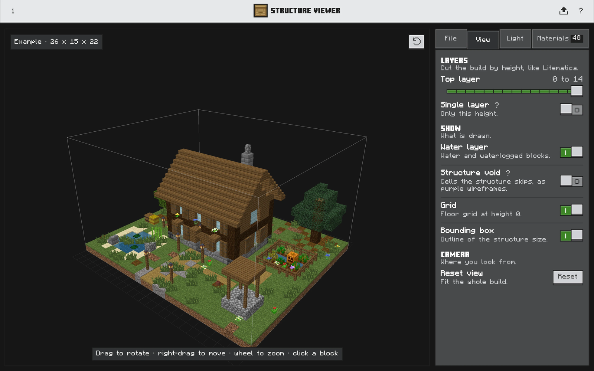
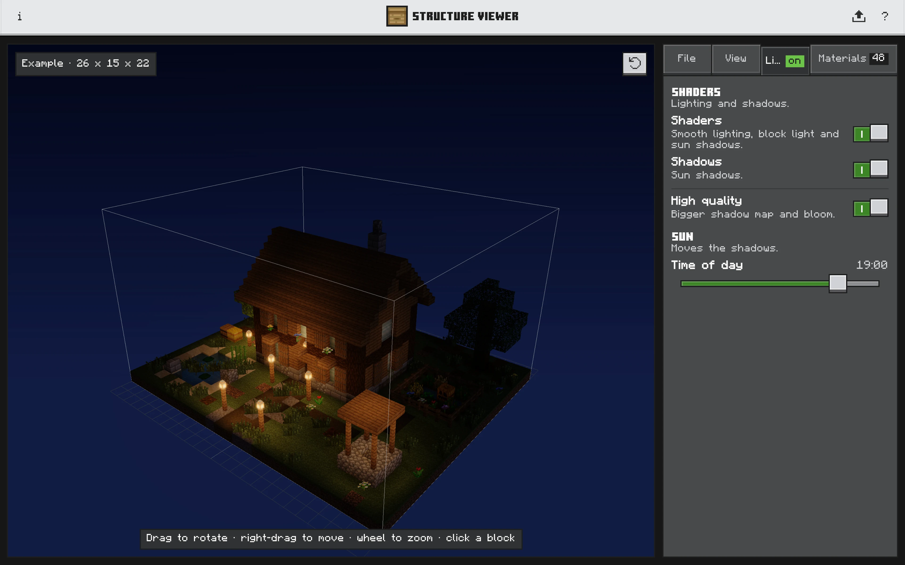
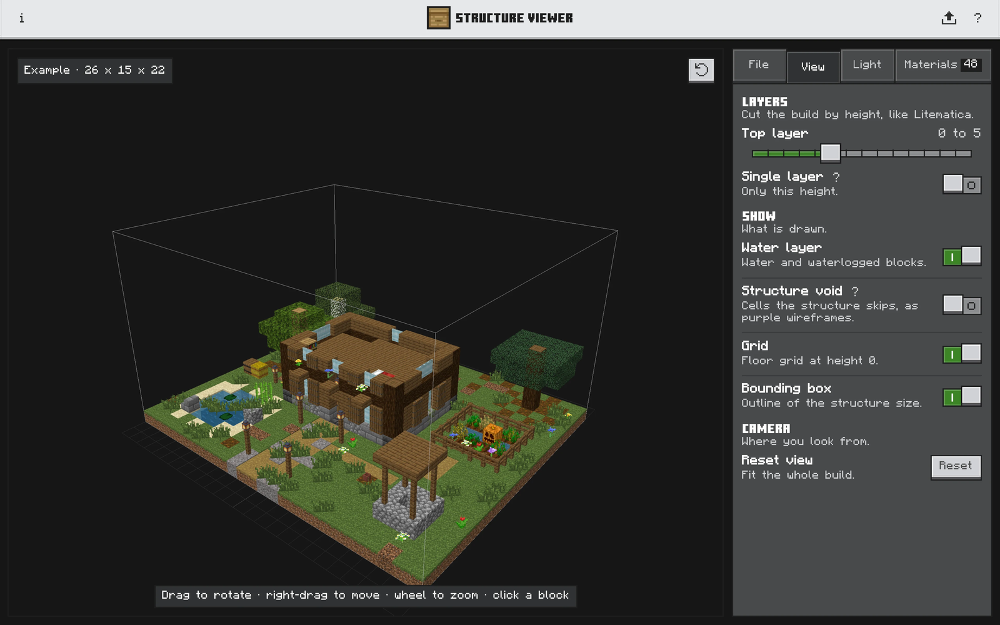
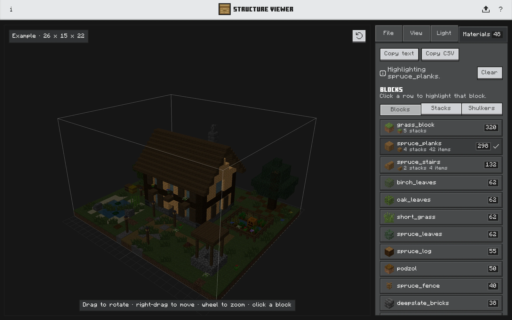

# Structure Viewer

Opens .mcstructure files in 3D in the browser. It uses real block textures and shapes, real entity models and an optional shaders mode.

**Open it:** https://duskaraa.github.io/structure-viewer/

## Features

- **Real textures:** From bedrock-samples
- **Block shapes:** Stairs, slabs, panes
- **Entities:** Real models
- **Shaders:** Shadows, AO, bloom
- **Layers:** Cut layer by layer
- **Materials:** Count and highlight

## Screenshots

Shaders at 19:00. Torches and lanterns light the build.

Layers: cut the build by height.

Materials: counts for every block, and a click highlights it in the build.

## About

Structure Viewer is a single HTML file with no install and no account. It runs fully in the browser; your files never leave your computer.

Made by [Duskaraa](https://duskaraa.github.io/).

Not an official Minecraft product. Not approved by or associated with Mojang or Microsoft.

## License

[MIT](LICENSE). Minecraft textures, fonts and screenshots belong to Mojang and are not covered by this license.
